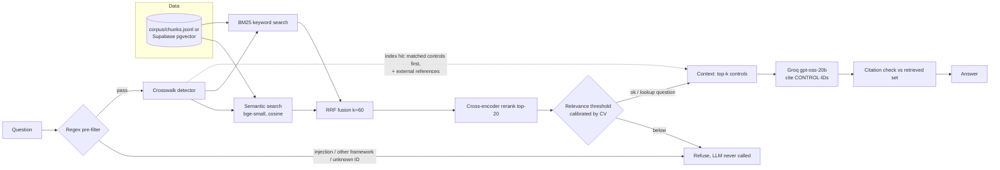

# Aegis: benchmarked retrieval over Singapore compliance controls

Aegis answers questions about the Singapore Government's **IM8 Reform** security controls (137 controls,
15 groups) with grounded, cited answers, and **measures** how well each stage works on a 124-question benchmark.
It is a retrieval-augmented generation (RAG) system built to be inspected: every stage between question and
answer is visible in the Pipeline Explorer, and every number in this README is produced by a committed script.

> **Honesty notes up front.** The benchmark's 61 curated questions were drafted with LLM assistance from the
> control text, and **none of the questions has been human-verified yet** (the `verified` flag is `false`
> throughout). Treat all results as provisional until they are verified. Details under [Limitations](#limitations).

## What it does

- **Hybrid retrieval**: semantic search (BAAI/bge-small-en-v1.5) + BM25 keyword search, merged with reciprocal rank fusion, then reranked by a cross-encoder.
- **Control-aware chunking**: one control = one chunk, with applicability levels (0/1/2 per risk class), OSCAL parameters rendered as `[agency-defined: …]`, and parsed references to NIST SP 800-53, MVSP, CIS v8, SLSA, CCM and legacy IM8.
- **Grounded generation** (Groq `openai/gpt-oss-20b`, temperature 0) that cites `[CONTROL-ID]`, with citations checked against the retrieved set.
- **Guardrail that does not trust the LLM**: a regex pre-filter (prompt injection, other frameworks/laws, unknown control IDs) and a calibrated relevance threshold decide to refuse in code, before the model is called.
- **Crosswalk mode**: "which controls reference MVSP 2.5?" and "which NIST references does AS-12 map to?" are answered from an inverted index over the structured references, because that data is not in the searchable text.
- **Pipeline Explorer**: a web page (FastAPI + Server-Sent Events) that shows pre-filter → semantic & BM25 ranks → RRF fusion → rerank scores → guardrail decision → cited answer.

## Architecture



## Quickstart

```bash
python -m venv .venv && source .venv/bin/activate
pip install -r requirements-dev.txt -c constraints.txt
cp .env.example .env          # add GROQ_API_KEY for answer generation
python -m pytest -q           # offline: fakes only
python -m scripts.ask "How often should backups be tested?"
uvicorn app.main:app          # Pipeline Explorer at http://localhost:8000
```

The default retrieval backend is **local** (reads `corpus/chunks.jsonl`, vectors in memory), so no database is
needed. To use Supabase + pgvector instead: run `db/schema.sql`, set `DATABASE_URL`, run
`python -m scripts.load_chunks`, and start with `AEGIS_BACKEND=db`.

Rebuild the corpus from the source repo (`git clone https://github.com/GovTechSG/tech-standards data/raw/tech-standards`):
`python -m scripts.build_chunks`.

### Reproduce the evaluation

```bash
python -m eval.build_benchmark                    # generate + merge + validate eval/questions.jsonl
python -m eval.calibrate                          # fit the refusal threshold (cross-validated)
python -m eval.run_eval --retrieval-only          # no API key needed (this is what CI gates on)
python -m eval.run_eval                           # + Groq generation, cached in eval/cache/, backs off on HTTP 429
python -m eval.update_readme eval/results/<run>.json eval/results/<baseline>.json
```

## Results

<!-- RESULTS:START -->
Run `final.json` · date 2026-11-20 · commit `02729f5+dirty` · retrieval backend `local` · LLM `openai/gpt-oss-20b`

**124 benchmark questions, 124 of them human-unverified.** All curated questions were drafted with LLM assistance; gold labels are pending manual verification; every metric below carries that caveat.

### Retrieval ablation

Answerable questions that have gold controls. Set-recall = fraction of gold controls found; hit = at least one found.

| method | n | unverified | MRR | set-recall@5 | set-recall@20 | hit@5 | hit@20 |
|---|---|---|---|---|---|---|---|
| semantic | 98 | 98 | 0.577 | 0.638 | 0.762 | 0.704 | 0.796 |
| bm25 | 98 | 98 | 0.761 | 0.784 | 0.866 | 0.847 | 0.898 |
| hybrid | 98 | 98 | 0.735 | 0.768 | 0.877 | 0.827 | 0.908 |
| hybrid_rerank | 98 | 98 | 0.770 | 0.805 | 0.877 | 0.847 | 0.908 |
| hybrid_rerank_crosswalk | 98 | 98 | 0.937 | 0.951 | 0.999 | 0.990 | 1.000 |

MRR by category:

| category | n | semantic | bm25 | hybrid | hybrid_rerank | hybrid_rerank_crosswalk |
|---|---|---|---|---|---|---|
| agency_param | 6 | 0.917 | 1.000 | 0.917 | 1.000 | 1.000 |
| applicability | 10 | 0.228 | 1.000 | 0.698 | 0.950 | 0.950 |
| crosswalk | 15 | 0.051 | 0.121 | 0.127 | 0.060 | 1.000 |
| crosswalk_reverse | 5 | 0.129 | 0.400 | 0.409 | 0.540 | 1.000 |
| exact_id | 10 | 0.411 | 0.900 | 0.700 | 1.000 | 1.000 |
| group_list | 10 | 0.920 | 0.883 | 0.950 | 0.850 | 0.850 |
| multi_control | 7 | 1.000 | 0.875 | 1.000 | 1.000 | 1.000 |
| no_level | 13 | 0.528 | 1.000 | 0.938 | 0.885 | 0.885 |
| paraphrase | 22 | 0.917 | 0.811 | 0.906 | 0.880 | 0.880 |

### Crosswalk: baseline vs after (baseline run `baseline-pre-crosswalk.json`)

| category | n | metric | baseline (hybrid+rerank) | with crosswalk mode |
|---|---|---|---|---|
| crosswalk | 15 | set_recall@5 | 0.044 | 1.000 |
| crosswalk | 15 | set_recall@20 | 0.208 | 1.000 |
| crosswalk | 15 | hit@5 | 0.067 | 1.000 |
| crosswalk | 15 | mrr | 0.060 | 1.000 |
| crosswalk_reverse | 5 | set_recall@5 | 1.000 | 1.000 |
| crosswalk_reverse | 5 | set_recall@20 | 1.000 | 1.000 |
| crosswalk_reverse | 5 | hit@5 | 1.000 | 1.000 |
| crosswalk_reverse | 5 | mrr | 0.540 | 1.000 |

End-to-end answer correctness on those questions (guardrail config):

| category | baseline correct | with crosswalk correct | n answered (baseline / after) |
|---|---|---|---|
| crosswalk | 0.0% | 100.0% | 15 / 15 |
| crosswalk_reverse | 0.0% | 100.0% | 5 / 5 |

Caveat: crosswalk gold labels come from the same `references` data the index is built from, so the post-crosswalk numbers measure query detection and routing, not independent truth.

### Guardrail (abstention; positive class = should refuse)

Threshold configs use held-out thresholds (5-fold cross-validation). The regex pre-filter was written after seeing the benchmark's out-of-scope questions, so its numbers are in-sample and optimistic.

| config | n | unverified | precision | recall | F1 | false-refusal rate on answerable |
|---|---|---|---|---|---|---|
| none | 124 | 124 | 0.000 | 0.000 | 0.000 | 0.000 |
| prefilter_only | 124 | 124 | 1.000 | 0.846 | 0.917 | 0.000 |
| threshold_rerank_only_heldout | 124 | 124 | 0.714 | 0.769 | 0.741 | 0.082 |
| threshold_only_heldout | 124 | 124 | 0.952 | 0.769 | 0.851 | 0.010 |
| both_heldout | 124 | 124 | 0.962 | 0.962 | 0.962 | 0.010 |
| both_shipped_threshold | 124 | 124 | 1.000 | 0.962 | 0.980 | 0.000 |

Shipped threshold: feature `bm25_top1` ≥ 7.0827. Candidates (held-out F1): `rerank_top1` 0.491, `bm25_top1` 0.851.

### Generation (124/124 questions answered)

| config | n answerable | unverified | answer correct | false refusals | answers with all-valid citations | cited-ID validity | out-of-scope refused | abstention P / R / F1 |
|---|---|---|---|---|---|---|---|---|
| no_guardrail | 98 | 98 | 87.8% | 4.1% | 100.0% | 100.0% | 96.2% | 0.86 / 0.96 / 0.91 |
| guardrail | 98 | 98 | 87.8% | 4.1% | 100.0% | 100.0% | 100.0% | 0.87 / 1.00 / 0.93 |

Answer correctness by category (guardrail config):

| category | n | unverified | correct |
|---|---|---|---|
| agency_param | 6 | 6 | 100.0% |
| applicability | 10 | 10 | 100.0% |
| crosswalk | 15 | 15 | 100.0% |
| crosswalk_reverse | 5 | 5 | 100.0% |
| exact_id | 10 | 10 | 100.0% |
| group_list | 10 | 10 | 30.0% |
| multi_control | 7 | 7 | 85.7% |
| no_level | 13 | 13 | 76.9% |
| out_of_scope | 26 | 26 | 100.0% |
| paraphrase | 22 | 22 | 95.5% |

### RAGAS (6 of 15 sampled answers scored; 9 failed on judge JSON errors or rate limits; judge `openai/gpt-oss-20b via Groq`)

faithfulness 0.722 · answer relevancy 0.880. With n this small and a 20B judge these are indicative only; re-run `python -m eval.ragas_eval` to score more.
<!-- RESULTS:END -->

## Findings

<!-- FINDINGS:START -->
All figures are from `eval/results/final.json` and `eval/results/baseline-pre-crosswalk.json` (tables above). 98 answerable questions, none human-verified.

1. **Plain hybrid fusion regressed on identifier-style questions; reranking fixed it.** On `exact_id` questions ("What does AS-5 require?") MRR is 0.900 for BM25 alone, 0.700 for RRF hybrid and 1.000 after cross-encoder reranking (semantic alone: 0.411). Overall MRR: BM25 0.761, hybrid 0.735, hybrid+rerank 0.770. The overall gaps are small on 98 questions. On paraphrases the picture is mixed and I did not reproduce a large hybrid regression: MRR is 0.917 semantic, 0.906 hybrid, 0.880 hybrid+rerank, 0.811 BM25, so reranking slightly *lowers* paraphrase MRR here.
2. **A chunker bug hid content.** The first chunker kept only a control's top-level prose and dropped nested list items (e.g. NS-6's four certificate rules) and left OSCAL link UUIDs such as `[SP 800-63b](#e59c…)` in the text. Fixed by rendering nested parts and stripping link targets; regression tests now pin both (`tests/test_ingest.py`).
3. **Crosswalk questions fail without structured data, and are fixed by an index.** The searchable text does not contain a control's references. Baseline (hybrid+rerank) set-recall@20 on the 15 forward crosswalk questions was 0.208 and end-to-end answer correctness 0% (crosswalk and reverse); with crosswalk mode both are 100%. This is partly circular (see Limitations): it shows the routing works, not that the references are right.
4. **The rerank score is a poor refusal signal; BM25 top score is better.** Held-out F1 for "refuse when top rerank logit < t" was 0.491 (false-refusal rate 14.3% on answerable questions); for top BM25 score it was 0.851 (1.0%). The cross-encoder is trained for passage relevance, and many in-scope questions are terse or lookup-style. The pre-filter plus threshold reaches held-out F1 0.962, but the pre-filter part is in-sample.
5. **Citations are valid but often absent.** Every citation the model produced was in the retrieved set (cited-ID validity 100%), yet only 68.1% of answers on answerable questions contain any `[ID]` citation (0 of 10 group listings, 1 of 5 reverse crosswalk answers). "Valid" here does not mean "present".
6. **Remaining weak spots.** `group_list` answers are correct only 30% of the time because the context holds 5 controls while groups have up to 11 (retrieval set-recall@20 is 0.988, @5 is 0.652); a group-lookup like the crosswalk index would fix it. `no_level` is 76.9%: the 3 misses are questions about the risk class a control has no level for, where the model declined to answer instead of saying "no level is defined"; it never invented a level.
<!-- FINDINGS:END -->

## Limitations

- **Benchmark provenance.** 63 generated questions have gold labels copied from catalogue data and independently re-checked by `eval/validate.py`. The 61 curated questions (paraphrases, agency-defined values, out-of-scope, multi-control) were drafted with LLM assistance from the control text. **No question has been human-verified yet**; the validator checks structure and derivable labels, not whether a paraphrase's single gold control is the only reasonable answer.
- **Small benchmark.** 124 questions, 26 of them unanswerable; differences of a few points are within noise.
- **Pre-filter is in-sample.** Its patterns were written after seeing the benchmark's out-of-scope questions, so its recall on unseen questions is likely lower than reported. The threshold is cross-validated, the pre-filter is not.
- **Crosswalk gold is circular.** Crosswalk questions are scored against the same `references` data the index is built from: the after-fix numbers measure detection and routing, not independent truth.
- **Regex answer checks.** Structured correctness (levels, "agency-defined", "no level") is checked with pattern matching on the model's text; it can mis-grade unusual phrasings in either direction.
- **Single catalogue snapshot.** Version 2025.05.13 of an archived repository; later changes upstream are not reflected. No profile in this release sets parameter values, so numeric parameters are always "agency-defined".
- **Not legal or compliance advice.** Answers come from a small model over a public catalogue and are not authoritative.

## Credits and licence

- Source data: **IM8 Reform catalogue**, © 2024 Government Technology Agency of Singapore (GovTech), MIT licence, from
  [github.com/GovTechSG/tech-standards](https://github.com/GovTechSG/tech-standards) (an archived repository; this project uses the
  catalogue version **2025.05.13** snapshot). The MIT notice is reproduced in [THIRD_PARTY_NOTICES.md](THIRD_PARTY_NOTICES.md).
  Aegis is an independent project and is not affiliated with or endorsed by GovTech.
- Models: BAAI/bge-small-en-v1.5, cross-encoder/ms-marco-MiniLM-L-6-v2, OpenAI gpt-oss-20b served by Groq.
- Aegis code: MIT, see [LICENSE](LICENSE).
