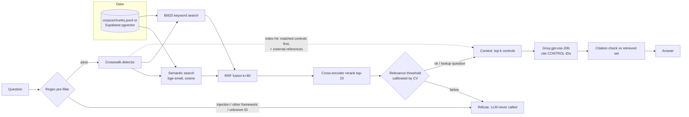

# Aegis: benchmarked retrieval over Singapore compliance controls

Aegis answers questions about the Singapore Government's **IM8 Reform** security controls (137 controls,
15 groups) with grounded, cited answers, and **measures** how well each stage works on a 124-question benchmark.
It is a retrieval-augmented generation (RAG) system built to be inspected: every stage between question and
answer is visible in the Pipeline Explorer, and every number in this README is produced by a committed script.

> **Honesty notes up front.** The benchmark's 61 curated questions were drafted with AI assistance from the
> control text, and **none of the questions has been human-verified yet** (the `verified` flag is `false`
> throughout). Treat all results as provisional until they are verified. Details under [Limitations](#limitations).

## What it does

- **Hybrid retrieval**: semantic search (BAAI/bge-small-en-v1.5) + BM25 keyword search, merged with reciprocal rank fusion, then reranked by a cross-encoder.
- **Control-aware chunking**: one control = one chunk, with applicability levels (0/1/2 per risk class), OSCAL parameters rendered as `[agency-defined: …]`, and parsed references to NIST SP 800-53, MVSP, CIS v8, SLSA, CCM and legacy IM8.
- **Grounded generation** (Groq `openai/gpt-oss-20b`, temperature 0) that cites `[CONTROL-ID]`, with citations checked against the retrieved set.
- **Guardrail that does not trust the LLM**: a regex pre-filter (prompt injection, other frameworks/laws, unknown control IDs) and a calibrated relevance threshold decide to refuse in code, before the model is called.
- **Crosswalk mode**: "which controls reference MVSP 2.5?" and "which NIST references does AS-12 map to?" are answered from an inverted index over the structured references, because that data is not in the searchable text.
- **Pipeline Explorer**: a web page (FastAPI + Server-Sent Events) that shows pre-filter → semantic & BM25 ranks → RRF fusion → rerank scores → guardrail decision → cited answer.

## Architecture



## Quickstart

```bash
python -m venv .venv && source .venv/bin/activate
pip install -r requirements-dev.txt -c constraints.txt
cp .env.example .env          # add GROQ_API_KEY for answer generation
python -m pytest -q           # offline: fakes only
python -m scripts.ask "How often should backups be tested?"
uvicorn app.main:app          # Pipeline Explorer at http://localhost:8000
```

The default retrieval backend is **local** (reads `corpus/chunks.jsonl`, vectors in memory), so no database is
needed. To use Supabase + pgvector instead: run `db/schema.sql`, set `DATABASE_URL`, run
`python -m scripts.load_chunks`, and start with `AEGIS_BACKEND=db`.

Rebuild the corpus from the source repo (`git clone https://github.com/GovTechSG/tech-standards data/raw/tech-standards`):
`python -m scripts.build_chunks`.

### Reproduce the evaluation

```bash
python -m eval.build_benchmark                    # generate + merge + validate eval/questions.jsonl
python -m eval.calibrate                          # fit the refusal threshold (cross-validated)
python -m eval.run_eval --retrieval-only          # no API key needed (this is what CI gates on)
python -m eval.run_eval                           # + Groq generation, cached in eval/cache/, backs off on HTTP 429
python -m eval.update_readme eval/results/<run>.json eval/results/<baseline>.json
```

## Results

<!-- RESULTS:START -->
(results are inserted by `python -m eval.update_readme`)
<!-- RESULTS:END -->

## Findings

<!-- FINDINGS:START -->
<!-- FINDINGS:END -->

## Limitations

- **Benchmark provenance.** 63 generated questions have gold labels copied from catalogue data and independently re-checked by `eval/validate.py`. The 61 curated questions (paraphrases, agency-defined values, out-of-scope, multi-control) were drafted by an AI assistant from the control text. **No question has been human-verified yet**; the validator checks structure and derivable labels, not whether a paraphrase's single gold control is the only reasonable answer.
- **Small benchmark.** 124 questions, 26 of them unanswerable; differences of a few points are within noise.
- **Pre-filter is in-sample.** Its patterns were written after seeing the benchmark's out-of-scope questions, so its recall on unseen questions is likely lower than reported. The threshold is cross-validated, the pre-filter is not.
- **Crosswalk gold is circular.** Crosswalk questions are scored against the same `references` data the index is built from: the after-fix numbers measure detection and routing, not independent truth.
- **Regex answer checks.** Structured correctness (levels, "agency-defined", "no level") is checked with pattern matching on the model's text; it can mis-grade unusual phrasings in either direction.
- **Single catalogue snapshot.** Version 2025.05.13 of an archived repository; later changes upstream are not reflected. No profile in this release sets parameter values, so numeric parameters are always "agency-defined".
- **Not legal or compliance advice.** Answers come from a small model over a public catalogue and are not authoritative.

## Credits and licence

- Source data: **IM8 Reform catalogue**, © 2024 Government Technology Agency of Singapore (GovTech), MIT licence, from
  [github.com/GovTechSG/tech-standards](https://github.com/GovTechSG/tech-standards) (an archived repository; this project uses the
  catalogue version **2025.05.13** snapshot). The MIT notice is reproduced in [THIRD_PARTY_NOTICES.md](THIRD_PARTY_NOTICES.md).
  Aegis is an independent project and is not affiliated with or endorsed by GovTech.
- Models: BAAI/bge-small-en-v1.5, cross-encoder/ms-marco-MiniLM-L-6-v2, OpenAI gpt-oss-20b served by Groq.
- Aegis code: MIT, see [LICENSE](LICENSE).
